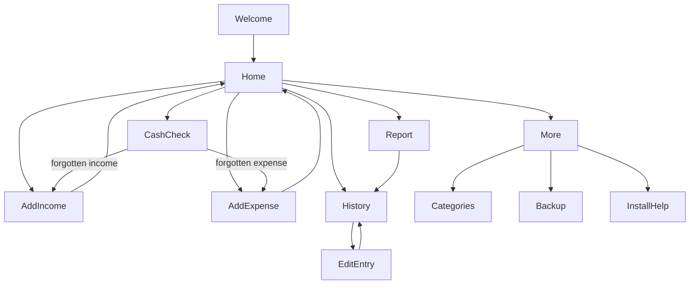

# AppFlow: Taka Khata

Routing uses hash routes (HashRouter) so it works on any static host.

## Screen / route list
| Route | Screen | Purpose |
|---|---|---|
| `#/welcome` | Welcome | First launch only: choose language (Bangla / English), one "Start" button |
| `#/` | Home | Balance, two big buttons, this month totals, last 5 entries |
| `#/add/income` | AddIncome | Record money received |
| `#/add/expense` | AddExpense | Record money spent |
| `#/edit/:id` | EditEntry | Edit or delete one entry (form depends on its type) |
| `#/history` | History | All entries, grouped by day, month + type + category filters |
| `#/report` | Report | Month summary and spent-by-category bars |
| `#/check` | CashCheck | Compare expected money with real money in hand |
| `#/more` | More | Language, links to the screens below |
| `#/more/categories` | Categories | Add, rename, hide categories |
| `#/more/backup` | Backup | Export JSON, import JSON |
| `#/more/install` | InstallHelp | How to install on phone |

Bottom navigation (always visible except on forms): Home, History, Report, More. The Cash Check is opened from a card on Home and from Report.

## Navigation map


## Redirect rules
- If `settings.language` is not set (first launch), any route redirects to `#/welcome`.
- Unknown route redirects to `#/`.
- `#/edit/:id` with an id that does not exist redirects to `#/history`.

## State machines

### Entry form (AddIncome, AddExpense, EditEntry)
| State | Event | Next state | Side effect |
|---|---|---|---|
| `idle` | open form | `editing` | prefill defaults (date = today) |
| `editing` | tap Save | `validating` | none |
| `validating` | invalid | `editing` | show field error text under the field |
| `validating` | valid | `saving` | disable Save button |
| `saving` | repo success | `saved` | none |
| `saving` | repo failure | `error` | show retry message |
| `saved` | auto | route `#/` (or `#/history` for edits) | show a short "Saved" toast |
| `error` | tap Retry | `saving` | none |
| `editing` | tap Back with changes | `confirmDiscard` | show "Discard changes?" |
| `confirmDiscard` | Yes | previous route | none |
| `confirmDiscard` | No | `editing` | none |

Validation rules: amount must be a number greater than 0 with at most 2 decimals and at most 9,999,999.99; expense needs a category; date must not be in the future.

### Delete entry
| State | Event | Next state | Side effect |
|---|---|---|---|
| `idle` | tap Delete | `confirmDelete` | dialog "Delete this entry?" |
| `confirmDelete` | Yes | `deleted` | entry soft-removed from view, toast with Undo (5 s) |
| `deleted` | tap Undo within 5 s | `idle` | entry restored |
| `deleted` | 5 s pass | `idle` | entry permanently deleted |
| `confirmDelete` | No | `idle` | none |

### Cash check
| State | Event | Next state | Side effect |
|---|---|---|---|
| `input` | enter amount, tap Check | `result` | compute expected, difference, save to `cashChecks` |
| `result` (diff = 0) | none | `result` | show "Matches" |
| `result` (diff < 0) | tap "Add forgotten expense" | route `#/add/expense?amount=X&category=other` | none |
| `result` (diff > 0) | tap "Add forgotten income" | route `#/add/income?amount=X` | none |
| `result` | tap "Check again" | `input` | clear input |

### Import backup
| State | Event | Next state | Side effect |
|---|---|---|---|
| `idle` | pick file | `parsing` | read file |
| `parsing` | invalid file | `error` | show "This file is not a Taka Khata backup" |
| `parsing` | valid | `confirmReplace` | show counts of entries found, warn that current data will be replaced |
| `confirmReplace` | Yes | `importing` | replace all tables in one transaction |
| `importing` | success | `done` | show success message |
| `importing` | failure | `error` | nothing changed (transaction rolled back) |

## Key user flows

### Flow 1: Father sends money
Home, tap "Received", type amount, (from defaults to Baba), Save, Home shows new balance.

### Flow 2: Pay the cook
Home, tap "Spent", type amount, tap "Cook" tile, Save, Home shows new balance.

### Flow 3: End of month check
Home, tap "Check my money", type real money in hand, see result; if short, tap the button, save the forgotten expense.

## Routing/state code contract
File `src/app/routes.ts` exports exactly:
```ts
export const ROUTES = {
  welcome: '/welcome',
  home: '/',
  addIncome: '/add/income',
  addExpense: '/add/expense',
  edit: '/edit/:id',
  history: '/history',
  report: '/report',
  check: '/check',
  more: '/more',
  categories: '/more/categories',
  backup: '/more/backup',
  install: '/more/install',
} as const;

export type FormState = 'idle' | 'editing' | 'validating' | 'saving' | 'saved' | 'error' | 'confirmDiscard';
export type DeleteState = 'idle' | 'confirmDelete' | 'deleted';
export type CheckState = 'input' | 'result';
export type ImportState = 'idle' | 'parsing' | 'confirmReplace' | 'importing' | 'done' | 'error';
```
State transition logic lives in pure reducer functions in `src/app/machines.ts` and is unit tested.
