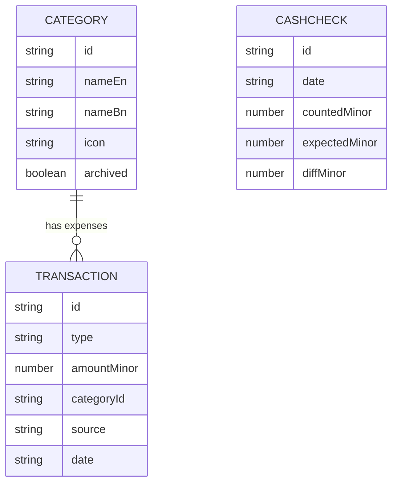

# Schema: Taka Khata

Storage: IndexedDB on the user's phone via Dexie. No server. Database name: `takakhata`. Current schema version: 1.

## Conventions
- `id`: string, created with `crypto.randomUUID()`.
- Money: integer `amountMinor` in poisha (1 taka = 100 poisha). Example: 250.50 taka is 25050.
- Dates: local calendar date `YYYY-MM-DD` string. Month key: `YYYY-MM`.
- Timestamps: `createdAt`, `updatedAt` as epoch milliseconds (number).

## Tables

### transactions
| Field | Type | Required | Notes |
|---|---|---|---|
| id | string | yes | primary key |
| type | `'income' \| 'expense'` | yes | |
| amountMinor | number (positive integer) | yes | max 999999999 |
| categoryId | string \| null | expense: yes, income: null | references categories.id |
| source | string \| null | no | income only, who sent it (for example "Baba") |
| note | string | no | default empty string, max 140 chars |
| date | string `YYYY-MM-DD` | yes | not in the future when saved |
| createdAt | number | yes | |
| updatedAt | number | yes | |

Indexes: `id` (primary), `date`, `type`, `categoryId`, `[type+date]`.

### categories
| Field | Type | Required | Notes |
|---|---|---|---|
| id | string | yes | default categories use fixed ids listed below |
| nameEn | string | yes | |
| nameBn | string | yes | |
| icon | string | yes | one of: `home, user, utensils, wifi, zap, flame, bus, book, tag, shopping-bag, heart, phone` |
| isDefault | boolean | yes | |
| archived | boolean | yes | hidden from pickers when true |
| sortOrder | number | yes | |

Indexes: `id` (primary), `sortOrder`.

Default categories (seeded on first run, fixed ids):
| id | nameEn | nameBn | icon |
|---|---|---|---|
| `hostel` | Hostel Rent | হোস্টেল ভাড়া | home |
| `cook` | Cook | রান্নার খালা | user |
| `food` | Food | খাবার | utensils |
| `wifi` | Wifi | ওয়াইফাই | wifi |
| `electricity` | Electricity | কারেন্ট বিল | zap |
| `gas` | Gas | গ্যাস বিল | flame |
| `transport` | Transport | যাতায়াত | bus |
| `study` | Study | পড়াশোনা | book |
| `other` | Other | অন্যান্য | tag |

### cashChecks
| Field | Type | Required | Notes |
|---|---|---|---|
| id | string | yes | primary key |
| date | string `YYYY-MM-DD` | yes | |
| countedMinor | number | yes | real money in hand |
| expectedMinor | number | yes | balance at that moment |
| diffMinor | number | yes | counted minus expected (negative = missing money) |
| createdAt | number | yes | |

Indexes: `id`, `date`.

### settings (key-value)
| key | value | default |
|---|---|---|
| `language` | `'bn' \| 'en'` | unset until Welcome screen |
| `schemaVersion` | number | 1 |

Table `settings`: primary key `key`, field `value`.

## Calculations (all in `src/data/calc.ts`, pure functions, fully tested)
- `balance(transactions)` = sum of income minus sum of expense (all time).
- `monthTotals(transactions, 'YYYY-MM')` returns `{ incomeMinor, expenseMinor, leftMinor }`.
- `expenseByCategory(transactions, 'YYYY-MM')` returns array of `{ categoryId, totalMinor, percent }` sorted by `totalMinor` descending. Percent is rounded to a whole number, computed from total spent that month.
- `diffForCheck(countedMinor, expectedMinor)` returns counted minus expected.

## Relationships
- One category has many transactions (expense only). Income has no category.
- Archived categories stay valid for old transactions.



## Backup file format
JSON file named `taka-khata-backup-YYYY-MM-DD.json`:
```json
{
  "app": "taka-khata",
  "schemaVersion": 1,
  "exportedAt": 1730000000000,
  "transactions": [],
  "categories": [],
  "cashChecks": [],
  "settings": []
}
```
Import must reject files where `app` is not `taka-khata` or `schemaVersion` is greater than the app's version, and must validate every record against the rules above before replacing anything.

## Migration policy
Schema changes are written in this file FIRST, then a new Dexie version with an upgrade function is added, then code changes. Never edit an existing version block.
